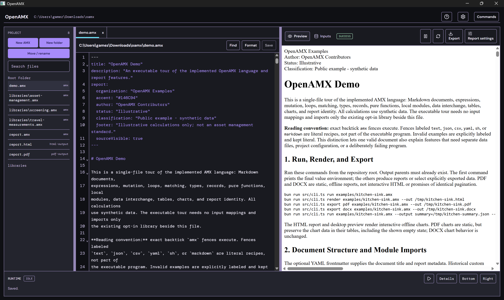

# OpenAMX



OpenAMX is a text-based format and toolset for **computable documents**. Write
an explanation in Markdown, add calculations in executable `amx` code blocks,
and refer to their results inline with `{{ expressions }}`. The document,
analysis, and report stay together in a readable, versionable `.amx` file.

OpenAMX is domain-neutral: you define the calculations and data structures for
your work. The included asset-management examples are optional demonstrations,
not certified risk models or industry standards.

## What you can do

- **Write and calculate in one document.** Markdown provides the narrative;
  only exact, case-sensitive `amx` fences execute. Inline expressions display
  evaluated results in the report.
- **Model real data.** Use typed records, enums, pure functions, local modules,
  and explicitly mapped JSON or CSV inputs. Validate inputs and export named
  results as JSON or CSV.
- **Build visual explanations.** Create tables, charts, and formula-driven 2D
  diagrams alongside the narrative.
- **Use the latest language additions.** V0.14 adds runtime type predicates,
  mathematical functions, text helpers, and bounded numeric formatting with
  `en-US`, `de-DE`, and `fr-FR` locales. Earlier additions include record
  inheritance, enums, and braced conditionals.
- **Publish reports in familiar formats.** Render standalone, offline HTML or
  export PDF and DOCX. Charts are interactive in HTML; PDF charts are static
  with their data retained in tables. DOCX charts are editable native charts
  when the chart can be represented.
- **Choose your authoring environment.** Use the command-line interface (CLI),
  the offline-first desktop workbench, or the VS Code extension.

## A small example

Save this as `analysis.amx`:

````markdown
# Review

The adjusted score is {{ score }}.

```amx
let score = 10
score += 5
```
````

The inline expression displays `15`. Ordinary Markdown and other code fences
remain narrative; they are not executed.

## Install

Choose the tool that fits your workflow. Prebuilt downloads are available from
the [GitHub Releases page](https://github.com/NovaEnergyConsulting/openamx/releases).
Release builds are unsigned, so your operating system may show a warning.

### CLI

The CLI is published to npm as `@nova-energy/openamx` and runs on
[Bun](https://bun.sh/) 1.0 or newer. Node.js and Deno are not supported.

1. Install Bun using the instructions at [bun.sh](https://bun.sh/).
2. Install OpenAMX:

   ```sh
   bun add -g @nova-energy/openamx
   ```

3. Verify it:

   ```sh
   openamx --version
   openamx --help
   ```

To try it without a global install, run `bunx @nova-energy/openamx --help`.
To uninstall the global package, run `bun remove -g @nova-energy/openamx`.

### Desktop app

Download the installer for your platform from the
[Releases page](https://github.com/NovaEnergyConsulting/openamx/releases). The
app includes its own runtime; Bun and Node.js are not required.

- **Linux x64:** extract the `OpenAMX-Desktop-<version>-linux-x64.tar.gz`
  archive and run `./installer`. The app requires WebKitGTK 4.1, GTK, and
  related system libraries. The current Linux x64 installer has been reported
  to launch and work, but broad Linux compatibility has not been established.
- **Windows:** extract the Setup `.zip` and run the Setup program it contains.
- **macOS:** open the `.dmg` and follow the installer.

Windows, macOS, and Linux arm64 builds have not been formally verified. See the
[desktop guide](desktop-app/README.md) for current platform notes and
installation details.

### VS Code extension

The extension requires VS Code 1.85.0 or newer. It is not yet available on the
Visual Studio Marketplace; install the VSIX from the
[Releases page](https://github.com/NovaEnergyConsulting/openamx/releases):

```sh
code --install-extension openamx-vscode-<version>.vsix
```

The extension provides OpenAMX editing support, including formatting,
completion, diagnostics, hover, navigation, outline, references, and contextual
fixes. It analyzes source; running documents and validating CSV/JSON inputs are
CLI or desktop workbench tasks. See the
[VS Code guide](vscode-extension/README.md).

## Try OpenAMX

With the CLI installed, run a document, render it to HTML, or export a PDF:

```sh
openamx run examples/hello-world.amx
openamx render examples/hello-world.amx --out hello-world.html
openamx export pdf examples/hello-world.amx --out hello-world.pdf
```

For documents that use external data, map each declared logical input
explicitly with `--input name=path`. See the
[typed-data example](examples/typed-asset-analysis.amx) and the CLI help for
all options. The desktop workbench offers project browsing, live preview,
structured JSON/CSV editing, input mapping, report settings, and a unified
HTML/PDF/DOCX export workflow.

## Examples and documentation

- [Hello OpenAMX](examples/hello-world.amx) introduces the document format.
- [Kitchen Sink](examples/kitchen-sink.amx) demonstrates language constructs.
- [Typed Asset Screening Analysis](examples/typed-asset-analysis.amx) shows
  typed local JSON/CSV inputs and named outputs.
- [V0.13 crank-slider diagram](examples/v0.13-crank-slider.amx) demonstrates
  formula-driven geometry.
- V0.14 examples: [runtime type checks](examples/v0.14-runtime-type-checks.amx),
  [math and Measurements](examples/v0.14-math-and-measurements.amx), and
  [text and formatting](examples/v0.14-text-and-formatting.amx).

Read the [V0.14 language specification](docs/language-spec-v0.14.md) for the
current language additions, or browse the [examples](examples/) and
[documentation](docs/). The
[desktop guide](desktop-app/README.md) and
[VS Code guide](vscode-extension/README.md) cover their respective tools.

## Licensing

OpenAMX is offered under a dual-licensing model. You may use it under either:

1. The [GNU Affero General Public License v3.0 (AGPLv3)](LICENSE.md), subject
   to its terms, including the source-code obligations that apply to covered
   modified versions used over a network.
2. A separate written commercial license from Nova Energy Consulting Pty Ltd,
   for organizations that need rights outside the AGPLv3 terms.

The [commercial license overview](COMMERCIAL-LICENSE.md) describes the
commercial option; the definitive terms are set out in a separately executed
agreement. For inquiries, contact
[licensing@novaenergy.digital](mailto:licensing@novaenergy.digital).

## Scope and limitations

OpenAMX is designed for local documents, local modules, and explicitly mapped
local data files; it does not load remote packages or data. Hiding source in a
report is a presentation choice, not a confidentiality boundary. Protect source
files and inputs independently. Report formats work offline, but exact visual
parity across HTML, PDF, DOCX, and office applications is not guaranteed.

The Asset Management library and examples are opt-in demonstrations and have
not been domain-certified. Review the calculations and obtain appropriate
domain validation before relying on results.

## Contributing

Contributions are welcome. See [CONTRIBUTING.md](CONTRIBUTING.md) for
development and contribution guidance.
